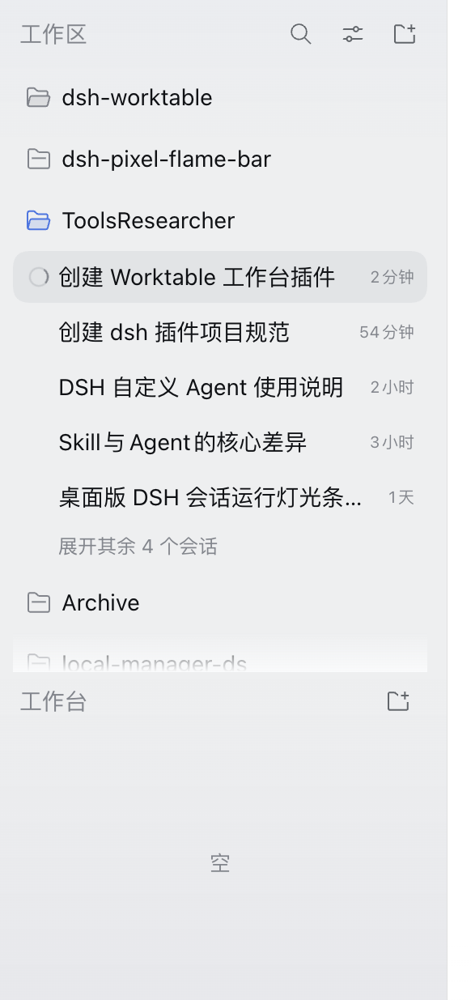
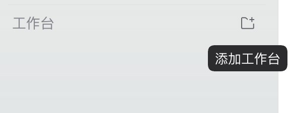

# dsh-worktable（工作台 / Worktable）

DSH 侧边栏插件：在左侧边栏主体内、**工作区下方**增加一个与工作区同级的「工作台 / Worktable」分区。工作区约占主体高度的 2/3，工作台约占 1/3，两块各自独立滚动，中间有一条极细的分割线。

当前版本（v0.1.0）只实现分区本身：

- 位于工作区列表下方、设置行上方；工作区约 2/3，工作台约 1/3。
- 工作台上方一条 `0.5px` 细线（`--dsw-alias-border-l1`），与工作区分开。
- 工作区内容超出可视高度时，在工作区底部（紧贴分割线上方）显示 24px 的淡出渐变，表示下面还有内容；滚动到列表末尾或内容未溢出时自动隐藏。渐变与自带 Workspace 浏览器的 fade 使用同一高度与 `--dsw-specific-sidebar-fill`，并在自带 fade 可见的平台（非 macOS）自动停用，避免叠加。
- 顶部是静态分区头：左侧本地化标题「工作台 / Worktable」，右侧的添加按钮使用与原生工作区**完全相同**的文件夹加号图标（`IconProjectAddOutlineRegular`，16px / 1px 描边）；**没有展开 / 收起交互**。
- 添加按钮在 hover / focus 时显示与原生 `Tooltip` 同样的提示气泡：同样的主题 token、13px 字号、下方 8px 间距、500ms hover 延迟，空间不足时翻到上方；因添加工作台暂无快捷键，不显示快捷键行。
- 列表区始终显示；尚无工作台项目时，在列表区中央显示「空 / Empty」。
- 标题、提示、空状态文案全部通过 Client locale 服务注册，跟随 DSH 语言设置实时切换（简体中文 / English）。
- 侧边栏收起为 56px 导轨时隐藏该分区；主题只使用 DSH 的 alias/static token，深色 / 浅色一致。

「添加工作台」按钮的行为（创建、命名、持久化工作台项目）属于下一步，当前点击不会新增项目。



（实际运行截图：工作区约 2/3，工作台约 1/3，中间为细分隔线，空态居中。）



（添加按钮 hover 500ms 后的提示：与原生工作区按钮同图标、同样式。）

## 目录结构

```text
dsh-worktable/
├── package.json        # bundle 清单：dsh.bundle.patch + dsh.client
├── cordis.patch.yml    # 插入 worktable 插件行
├── index.js            # Host 半：空实现（入口完全在浏览器侧）
├── client.js           # 浏览器半：注册 locale 字典与 sidebar.footer.action 入口
├── locale/en.json      # 插件管理页展示的英文标题与描述
├── locale/zh.json      # 插件管理页展示的中文标题与描述
├── icon.svg            # 插件图标（原创）
├── docs/               # 实际运行截图
└── README.md
```

## 安装

本插件是一个 DSH bundle，安装时以本目录为 target 执行 `plugin_manager` 的 `install_bundle`（可让 agent 代劳），随后刷新页面即可，无需重启应用。

卸载使用 `plugin_manager` 的 `remove_bundle`。

## 开发

无构建步骤，`client.js` 就是运行产物：

```bash
node --check client.js
```

修改 `client.js` 后重新安装 / 刷新页面查看效果。

## 设计说明

- **结构限制**：侧边栏主体是 `sidebar.workspaces` 这个 `single` slot（由 ui-workspace 的 WorkspaceBrowser 整体占用），ui-sidebar 没有提供“主体内同级分区列表”的座位。因此工作台只能先注册到工作区下方唯一的列表座位 `sidebar.footer.action`。
- **提升为同级分栏**：注册后通过 `display: contents` 把 `sidebar.footer.action` 的宿主容器（footer 动作行与 foot 容器）摊平，让工作台分区在布局上成为侧边栏列的直接子项；工作区容器设为 `flex: 2 1 0`，工作台设为 `flex: 1 1 0`，即 2:1。这是一处针对宿主侧边栏内部结构的 CSS 适配：自带结构变化时会退化为 footer 内条目，不会影响插件加载。
- **分割线**：工作台分区 `border-top: 0.5px solid var(--dsw-alias-border-l1)`，宽度跟随侧边栏内容区，浅色 / 深色都由 token 决定。
- **底部淡出**：自带 Workspace 浏览器其实渲染了底部 fade，但在 macOS 上被 `[data-platform=darwin]` 隐藏。工作台分区因此在自己的顶部上方绘制一条 24px 渐变（`bottom: 100%`），用 `MutationObserver` / `ResizeObserver` / `scroll` 监听工作区滚动容器，仅当内容溢出且未滚到末尾时显示；滚动容器按 `overflow-y` 计算值查找，不依赖哈希类名，视图切换替换容器时会自动重新绑定。
- **添加图标与提示**：图标路径直接取自自带 `IconProjectAddOutlineRegular`（文件夹 + 右上角加号，16px、1px 描边），与工作区按钮一致。提示气泡没有引入 `@deepseek-ai/dsh-client-ui-primitives`，而是按原生 `Tooltip` 的标记和样式复刻：`--dsw-alias-tooltip-bg` / `--dsw-static-neutral-bluish-00`、13px/20px、下方 8px、500ms 延迟、12px 视口内缩与上下翻转，`pointer-events: none`。
- **附带影响**：摊平只在工作台分区存在时生效；同一 footer 槽位的其它条目（例如会话运行灯条）也会随之成为侧边栏列的直接子项并按整行排列。关闭本插件后立即恢复原状。
- **本地化**：`ctx.locale.register('dsh-worktable', { zh, en })` 注册字典，slot 注册时传 `locale: 'dsh-worktable'`，组件从注入的 `t` 取文案；`locale/*.json` 只负责插件管理页的标题与描述。切换语言时 slot 会随 locale revision 重新渲染。
- **收起态**：侧边栏折叠为 56px 导轨时分区不渲染（`wide === false`），摊平规则随之失效，footer 恢复原布局。
- **无障碍**：分区头是静态标题行；列表区是 `role="group"` 并带本地化 `aria-label`；添加按钮有 `aria-label`，提示气泡使用 `role="tooltip"`，支持 hover 与键盘 focus。
